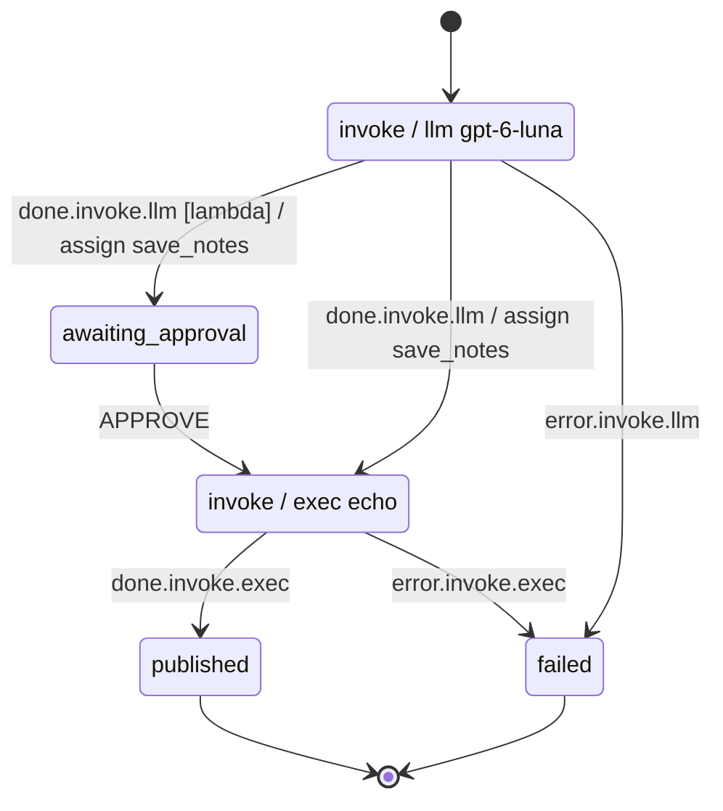

# Starness

**Statically typechecked Harel statecharts in Starlark — for deterministic workflows and multi-tier AI agents.**

YAML pipelines break down when you need loops, retries, typed data, parallel regions, or pause/resume. Unbounded Python/TypeScript agent loops are hard to visualize, hard to persist across human approvals, and easy to break at runtime.

**Starness** compiles pure `.star` statecharts into an immutable, graph-verified state machine (backed by Rust + `xstate-statemachine`) *before* a single token, subprocess, or HTTP call runs. One binary (`starness`) checks, diagrams, executes, serves over HTTP/SSE with SQLite persistence, or exposes any `.star` workflow as an ACP v1 agent.

---

## What a Starness Workflow Looks Like

```python
load("@starness/exec", "invoke_cmd")
load("@starness/llm", "invoke_llm", "llm_structured")

ReleaseNotes = record(headline = str, breaking = bool)
Ctx = record(commits = field(str, "feat: add @starness/llm"), headline = field(str, ""))
S = state_space("drafting", "awaiting_approval", "publishing", "published", "failed")

def save_notes(ctx: Ctx, ev: dict) -> Ctx:
    return update(ctx, headline = llm_structured(ev, ReleaseNotes).headline)

chart: StateMachine = machine(
    id = "release_gate",
    initial = S.drafting,
    context = Ctx(),
    states = {
        S.drafting: state(
            invoke = invoke_llm(
                model = "gpt-6-luna",
                prompt = lambda ctx: "Summarize commits:\n" + ctx.commits,
                schema = ReleaseNotes,
                on_done = [
                    outcome(
                        target = S.awaiting_approval,
                        guard = lambda _ctx, ev: llm_structured(ev, ReleaseNotes).breaking,
                        assign = save_notes,
                    ),
                    outcome(target = S.publishing, assign = save_notes),
                ],
                on_error = S.failed,
            ),
        ),
        S.awaiting_approval: state(
            on = [transition(event = "APPROVE", target = S.publishing)],
        ),
        S.publishing: state(
            invoke = invoke_cmd(cmd = ["echo", "published"], on_done = S.published, on_error = S.failed),
        ),
        S.published: final_state(output = {"status": "published"}),
        S.failed: final_state(output = {"status": "failed"}),
    },
)
```

`starness diagram` renders the exact verified control flow as Mermaid `stateDiagram-v2`:



---

## Why Starness?

- **Offline static typechecking & graph verification (`starness check`)** — Catches raw-string state targets, dangling `StateId`s, wrong `record(...)` / `enum(...)` field types, and `secret(...)` values leaked into `context` before any I/O runs.
- **Real Harel / XState v5 semantics** — `compound_state` hierarchy, `parallel_state` orthogonal regions, `shallow_history` / `deep_history`, `after` timers, `always` transitions, `forbid`, and automatic cancellation (`kill_on_drop`) of active subprocesses, HTTP calls, LLM streams, and agents on state exit.
- **4 tiers of execution in one graph** — Mix deterministic tools, calibrated System-1 routing, single-shot/multi-turn LLMs, and autonomous coding agents without writing Rust.
- **Lossless observability & durable hosting** — Stream every transition, token chunk, tool call, and redacted secret via `--trace -` (JSONL) or `starness serve --db starness.db` (multi-machine, multi-instance HTTP/SSE daemon with SQLite persistence).
- **Built for AI agents to author** — See [`AGENTS.md`](AGENTS.md) for the complete Starlark DSL contract and agent authoring loop (`write .star` → `starness check` → `starness diagram` → `starness run --trace -`).

---

## Choosing the Right `@starness/*` Module

| Tier | Module | Key Primitives | Use when you need… |
| :--- | :--- | :--- | :--- |
| **Deterministic** | `@starness/http` | `http_request`, `invoke_http`, `HttpMethod` | Async HTTP/TLS requests via `reqwest` (`rustls`) |
| **Deterministic** | `@starness/exec` | `exec_spec`, `invoke_cmd` | Subprocess execution with `kill_on_drop` cancellation on state exit |
| **Deterministic** | `@starness/mcp` | `mcp_stdio_server`, `mcp_http_server`, `invoke_mcp` | Direct MCP tool calls over `stdio` or Streamable HTTP |
| **Fast Routing** | `@starness/decide` | `noul`, `choice`, `score`, `jev`, `invoke_decision`, `is_yes`, `selected`, `prob` | Calibrated System-1 classification with probabilities & refusal fallback (`decision-rs`) |
| **LLM & Tools** | `@starness/llm` | `llm_model`, `invoke_llm`, `user_msg`, `assistant_msg`, `tool_def`, `tool_result`, `attachment`, `llm_structured` | Single-shot or multi-turn chat, native tool calling, lossless reasoning/thought-signature round-tripping, binary attachments, prompt caching, and Starlark `Record` extraction across all `genai` providers |
| **Autonomous Agents** | `@starness/acp` | `acp_agent`, `agy_agent`, `claude_agent`, `codex_agent`, `invoke_agent`, `artifact_tool`, `read_tool` | Multi-turn coding/tool agents over ACP v1 / CLI with turn-scoped MCP `read_tool`s and `record`-validated `artifact_tool`s |
| **Secrets** | `@starness/secrets` | `secret`, `SecretSource` (`env`, `file`, `keychain`) | Late-bound `ZeroizeOnDrop` secrets with automatic `<secret:NAME>` scrubbing in traces and errors |

---

## 5-Minute Quickstart

### 1. Check and diagram offline (zero I/O)

```bash
# Statically typecheck and graph-verify every example
cargo run -p starness-cli -- check examples/*.star

# Render a Harel Mermaid stateDiagram-v2 graph
cargo run -p starness-cli -- diagram examples/issue_autopilot.star
```

### 2. Run interactively with live JSONL traces

```bash
export OPENAI_API_KEY="sk-..."

# Interactive multi-turn coding harness (type JSON PROMPT events, INTERRUPT, or /exit)
cargo run -p starness-cli -- run examples/coding_session_llm.star \
  --events-stdin \
  --trace -
```

Send events on stdin:

```json
{"type":"PROMPT","text":"Check git status with bash"}
{"type":"PROMPT","text":"/exit"}
```

### 3. Host durable multi-instance workflows (`starness serve`)

```bash
# Serve an entire directory of .star files backed by SQLite WAL persistence
cargo run -p starness-cli -- serve examples/ --bind 127.0.0.1:8080 --db starness.db
```

Interact over HTTP + SSE from another terminal:

```bash
# Start an instance (returns InstanceSnapshot with `.id`)
ID=$(curl -s -X POST http://127.0.0.1:8080/machines/coding_session_llm/instances \
  -H 'content-type: application/json' -d '{}' | jq -r .id)

# Stream live tokens, tool calls, and transitions (SSE)
curl -N http://127.0.0.1:8080/machines/coding_session_llm/instances/$ID/trace &

# Send an event (non-blocking — transitions immediately and runs invokes asynchronously)
curl -s -X POST http://127.0.0.1:8080/machines/coding_session_llm/instances/$ID/events \
  -H 'content-type: application/json' \
  -d '{"type":"PROMPT","text":"List the crates in this workspace with bash"}' | jq '{status, active_states}'

# Poll snapshot once status returns to "waiting"
curl -s http://127.0.0.1:8080/machines/coding_session_llm/instances/$ID | jq '{status, turns, tool_runs, last_reply}'
```

### 4. Secrets, ACP server, and Starlark LSP

```bash
# Store and verify secrets in the OS Keychain (macOS Keychain, Windows Credential Manager, Linux Secret Service)
pbpaste | cargo run -p starness-cli -- secrets set OPENAI_API_KEY
cargo run -p starness-cli -- secrets check OPENAI_API_KEY

# Expose any .star workflow as an ACP v1 Agent over stdio (for Zed, Neovim, JetBrains, etc.)
cargo run -p starness-cli -- acp examples/multi_agent_acp.star

# Launch the Starlark LSP server over stdio
cargo run -p starness-cli -- lsp
```

---

## Examples Gallery

Every example in `examples/` is zero-compile (pure Starlark, no custom Rust required) and passes `starness check examples/*.star`:

| Example | Modules Used | Highlights |
| :--- | :--- | :--- |
| [`examples/coding_session_llm.star`](examples/coding_session_llm.star) | `llm`, `exec`, `secrets` | Interactive multi-turn coding REPL (`working { thinking <-> acting }`), native `bash` tool calling, `assistant_msg(ev)` lossless round-tripping, and `INTERRUPT` cancellation |
| [`examples/release_notes_llm.star`](examples/release_notes_llm.star) | `llm`, `exec`, `secrets` | Constrained-decoding Starlark `Record` + nested `Enum` extraction (`ReleaseSummary`), SSE streaming, and breaking-change approval gate |
| [`examples/parallel_review_llm.star`](examples/parallel_review_llm.star) | `llm` | Harel `parallel_state` fanning out a PR review across two models (`gpt-6-luna` + `gemini-2.5-flash`) with `on_done` consensus convergence |
| [`examples/issue_autopilot.star`](examples/issue_autopilot.star) | `decide`, `llm`, `acp`, `exec` | Flagship 3-tier composition: System-1 triage (`decide`) → structured `FixPlan` (`llm`) → autonomous coding agent (`acp` + `artifact_tool`) → test verification (`exec`) |
| [`examples/support_triage_decide.star`](examples/support_triage_decide.star) | `decide`, `exec` | Confidence-gated `noul`, `choice` (`enum`), and `score` triage with refusal fallback to human review |
| [`examples/mcp_issue_sync.star`](examples/mcp_issue_sync.star) | `mcp`, `llm`, `secrets` | Fetches a tracker issue via Streamable HTTP MCP, enriches it with `@starness/llm`, and writes back via `invoke_mcp` |
| [`examples/deployment_pipeline.star`](examples/deployment_pipeline.star) | `exec`, `http` | `compound_state`, `parallel_state` smoke + security checks, canary bake polling, `shallow_history` pause/resume, and `--events-stdin` approvals |
| [`examples/checkout_http.star`](examples/checkout_http.star) | `http` | Dynamic `after(delay = ...)` exponential retry backoff and `update(ctx, ...)` typed reducers |
| [`examples/ci_autofix_acp.star`](examples/ci_autofix_acp.star) | `exec`, `acp` | Lightweight test-and-autofix loop delegating failing builds to a coding agent |
| [`examples/multi_agent_acp.star`](examples/multi_agent_acp.star) | `acp`, `exec` | Multi-agent planner → coder → reviewer loop with turn-scoped MCP `read_tool`s and `record`-validated `artifact_tool`s |

---

## Building with AI Agents

If you are using a coding agent (Antigravity, Claude Code, Codex, Cursor) to write or modify `.star` workflows, point it at **[`AGENTS.md`](AGENTS.md)** — it contains the full Starlark DSL reference, `@starness/*` module signatures, common pitfalls, and the offline verification loop.

---

## Workspace Layout

- `crates/starness-ir` — Pure Rust statechart IR and static graph verifier (`MachineDef::validate`).
- `crates/starness-starlark` — Strongly typed Starlark 0.14 Harel / XState v5 DSL, ahead-of-time static typechecker, multi-file `load()` compiler, recursive JSON Schema derivation, and virtual `@starness/*` standard modules.
- `crates/starness-runtime` — Compiles `CompiledChart` into `xstate_core::Machine`, bridges frozen Starlark guards/delays/inputs/reducers with `HostCallbacks`, provides `StarnessSyncRunner`, Tokio `StarnessActor`, SQLite HTTP/SSE `serve` daemon, lossless `TraceHub`, Mermaid exporter, and built-in drivers (`http`, `exec`, `mcp`, `acp`, `decide`, `llm`, `secrets`).
- `bins/starness-cli` (`starness`) — Standalone CLI (`check`, `diagram`, `run`, `serve`, `secrets`, `acp`, `lsp`).
