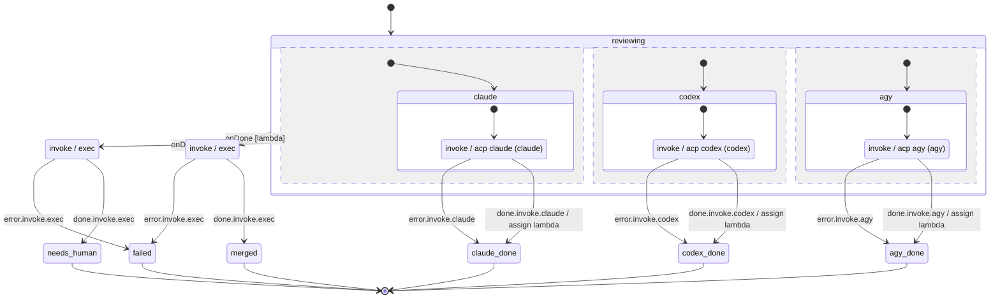

# Starness

**A typed DSL for deterministic AI workflows, agents, and harnesses, written in Rust™.**

Declare AI workflows in <a href="https://starlark-lang.org/" target="_blank" rel="noopener noreferrer">Starlark</a> (a battle-tested subset of Python backed by Google and Meta), using LLMs, Decision Models, Agent Client Protocol (ACP), and MCP, with built-in support for HTTP, CLI commands, and secrets. Starness files are small, easy to read and reason about — parsed and verified into an immutable, graph-verified hierarchical state machine before a single token, subprocess, or HTTP call runs.

---

## Example: Multi-Harness PR Auto-Approval Quorum

Run **Claude Code**, **Codex**, and **Antigravity** in parallel against a pull request, require a typed `Verdict` artifact from each, and automerge if at least 2 of 3 agree it is low-risk — otherwise post a PR comment explaining why automerge was skipped:

```python
load("@starness/acp", "agy_agent", "artifact", "artifact_tool", "claude_agent", "codex_agent", "invoke_agent")
load("@starness/exec", "invoke_cmd")

# Typed schema the coding harnesses must submit via MCP before their turn completes
Verdict = record(low_risk = bool, reason = str)

# Immutable workflow state (override pr_number at runtime with --context)
Ctx = record(
    pr_number = field(str, "123"),  # GitHub PR number to review
    approvals = field(int, 0),      # Count of harnesses that voted low_risk = True
)

# Typed state handles (typos or raw strings fail `starness check` before anything runs)
S = state_space(
    "reviewing",
    "claude", "claude_run", "claude_done",
    "codex", "codex_run", "codex_done",
    "agy", "agy_run", "agy_done",
    "merging", "commenting", "merged", "needs_human", "failed",
)

# Turn-scoped MCP tool injected into each coding harness to capture a validated Verdict
verdict_tool = artifact_tool("submit_verdict", description = "Record low_risk boolean", schema = Verdict)

# Helper that builds one parallel region: each region is a compound_state that runs an
# agent and transitions to final_state() so the parent parallel_state knows when it finishes.
def reviewer(agent, run_state, done_state):
    return compound_state(
        initial = run_state,
        states = {
            run_state: state(
                invoke = invoke_agent(
                    agent = agent,
                    prompt = lambda ctx: "Review PR #" + ctx.pr_number + " and call submit_verdict.",
                    tools = [verdict_tool],
                    on_done = outcome(
                        target = done_state,
                        # `update(...)` is a Starness built-in that returns a new immutable copy of ctx
                        assign = lambda ctx, ev: update(
                            ctx,
                            approvals = ctx.approvals + (1 if artifact(ev, "submit_verdict", Verdict).low_risk else 0),
                        ),
                    ),
                    on_error = done_state,  # Treat a crashed harness as a non-approval
                ),
            ),
            done_state: final_state(),
        },
    )

chart: StateMachine = machine(
    id = "pr_auto_merge",
    initial = S.reviewing,
    context = Ctx(),
    states = {
        # Fan out all 3 coding harnesses concurrently; `on_done` fires once all 3 reach final_state()
        S.reviewing: parallel_state(
            states = {
                S.claude: reviewer(claude_agent(id = "claude"), S.claude_run, S.claude_done),
                S.codex: reviewer(codex_agent(id = "codex"), S.codex_run, S.codex_done),
                S.agy: reviewer(agy_agent(id = "agy"), S.agy_run, S.agy_done),
            },
            on_done = [
                # Automerge if at least 2 of 3 harnesses voted low_risk = True
                outcome(target = S.merging, guard = lambda ctx, _ev: ctx.approvals >= 2),
                # Otherwise leave a PR comment explaining why automerge was skipped
                outcome(target = S.commenting),
            ],
        ),
        S.merging: state(
            invoke = invoke_cmd(
                cmd = lambda ctx: ["gh", "pr", "merge", ctx.pr_number, "--auto", "--squash"],
                on_done = S.merged,
                on_error = S.failed,
            ),
        ),
        S.commenting: state(
            invoke = invoke_cmd(
                cmd = lambda ctx: [
                    "gh", "pr", "comment", ctx.pr_number, "--body",
                    "Auto-merge skipped: reviewers did not reach a low-risk quorum.",
                ],
                on_done = S.needs_human,
                on_error = S.failed,
            ),
        ),
        S.merged: final_state(output = {"status": "merged"}),
        S.needs_human: final_state(output = {"status": "needs_human"}),
        S.failed: final_state(output = {"status": "failed"}),
    },
)
```

---

## Starness Diagrams

`starness diagram <file.star>` renders the verified control flow directly as a Mermaid `stateDiagram-v2` — including parallel regions (`--`), guards, reducers, and invoked services:



---

## Why Starness?

- **The best way to declare an AI agent, harness, or workflow** — Starness uses hierarchical state machines with an API small enough for both humans and agents to grok quickly, while supporting very complex workflow shapes.
- **Declarative, zero-compile, modular, and easy to share** — Start with a single readable `.star` (Starlark) file, or split shared types, guards, and models across multiple `.star` files with `load(...)`. No build step, easy to diff in Git, share with a teammate, or drop into `starness serve`.
- **Static typechecking & graph verification (`starness check`)** — Catches typos in state names, dangling targets, wrong `record(...)` / `enum(...)` field types, and `secret(...)` values accidentally stored in persisted `context` before any I/O runs.
- **Mix every tier of AI & tools in one workflow** — Combine decision models, direct LLM calls, existing coding harnesses (Claude Code, Codex, Antigravity, etc.), MCP servers, HTTP APIs, and shell commands without writing or compiling Rust.
- **Lossless, asynchronous observability & durable hosting** — Stream every state transition, token chunk, tool call, and redacted secret without blocking execution (`--trace -` JSONL or `starness serve --db` SSE), with SQLite persistence across restarts and human approvals.

---

## Install & Agent Skill

Install the `starness` CLI and the built-in Agent Skill so your coding agent (Antigravity, Claude Code, Codex, Cursor, etc.) can author, check, diagram, and run Starness workflows out of the box:

```bash
# 1. Install the starness CLI
cargo install --path bins/starness-cli

# 2. Install the Starness Agent Skill (skills/starness/SKILL.md)
npx skills add floodfx/starness
```

Or copy the skill directly from this repo:

```bash
# Antigravity (global)
cp -r skills/starness ~/.gemini/antigravity/skills/starness

# Claude Code (global)
cp -r skills/starness ~/.claude/skills/starness

# Project-local (.agents/skills)
cp -r skills/starness .agents/skills/starness
```

*(If running from a local clone without installing, substitute `cargo run -p starness-cli --` for `starness`.)*

---

## Hierarchical State Machine Features

Starness gives you structured control flow primitives that keep complex agent workflows predictable and visualizable:

- **Nested states (`compound_state`)** — Group related steps under a parent state (for example, `working { thinking <-> acting }`). A single `INTERRUPT` or `CANCEL` transition on `working` handles cancellation across every child state without repeating transitions.
- **Concurrent branches (`parallel_state`)** — Run multiple independent regions at the same time (such as multi-harness PR reviews or simultaneous smoke + security checks). `on_done` fires automatically once every region reaches its `final_state`.
- **Pause & resume (`shallow_history` / `deep_history`)** — Temporarily leave a multi-step flow (e.g., `PAUSE` during a deployment rollout) and transition back to a history node to resume in the exact substate you left off.
- **Timers & exponential backoff (`after`)** — Schedule fixed delays (`after(delay = 5000, ...)`) or dynamic context-driven delays (`after(delay = lambda ctx: 500 * (2 ** ctx.attempts), ...)`) for polling, timeouts, and retries. Timers cancel automatically if another event transitions the state first.
- **Automatic cancellation on state exit** — Every `invoke` (subprocesses, HTTP calls, streaming LLMs, and ACP agents) is bound to the lifetime of its state. Exiting or interrupting a state tears down in-flight work cleanly.
- **Guarded transitions & immutable reducers** — Express branching logic with typed `record(...)` state, `enum(...)` events, `update(ctx, ...)` shallow copies, `always` transitions, `internal_transition`, and `forbid`.

---

## Built-in, Powerful Capabilities

| Category | Module | Key Primitives | Use when you need… |
| :--- | :--- | :--- | :--- |
| **Decision Models** | `@starness/decide` | `noul`, `choice`, `score`, `jev`, `invoke_decision`, `is_yes`, `selected`, `prob` | Fast yes/no, enum choice, and scored routing with calibrated probabilities and human fallback |
| **LLMs & Tools** | `@starness/llm` | `llm_model`, `invoke_llm`, `user_msg`, `assistant_msg`, `tool_def`, `tool_result`, `attachment`, `llm_structured` | Single-shot or multi-turn chat, native tool calling, structured `Record` extraction, file/image attachments, and prompt caching across providers |
| **Coding Harnesses** | `@starness/acp` | `acp_agent`, `agy_agent`, `claude_agent`, `codex_agent`, `invoke_agent`, `artifact_tool`, `read_tool` | Delegate multi-turn coding tasks to Claude Code, Codex, Antigravity, or any ACP v1 agent with turn-scoped MCP read/artifact tools (or expose a workflow via `starness acp`) |
| **MCP** | `@starness/mcp` | `mcp_stdio_server`, `mcp_http_server`, `invoke_mcp` | Call tools on local (`stdio`) or remote (Streamable HTTP) MCP servers directly |
| **Deterministic** | `@starness/http` | `http_request`, `invoke_http`, `HttpMethod` | Call REST/JSON APIs, webhooks, health checks, and internal services |
| **Deterministic** | `@starness/exec` | `exec_spec`, `invoke_cmd` | Run shell commands, builds, test suites, or CLIs with automatic cancellation on state exit |
| **External UI View-Sheets** | `*.ui.json` (`--ui`) | `views`, `tag_views`, `$state` bindings | Keep `.star` workflows 100% headless while attaching optional `json-render` UIs to Web Studio (`/ui`) and Ratatui TUI (`starness run -i --ui`), statically verified by `starness check --ui` |
| **Secrets** | `@starness/secrets` | `secret`, `SecretSource` (`env`, `file`, `keychain`) | Load API keys and tokens from env vars, files, or the OS keychain with automatic `<secret:NAME>` redaction in traces and errors |

---

## How the AI Modules Feel in Practice

### 1. Decision Models (`@starness/decide`) — Calibrated Routing & Human Fallback

Ask structured yes/no (`noul`), enum (`choice`), and rated (`score`) questions, then gate autonomous actions on probability thresholds:

```python
Team = enum("BILLING", "TECHNICAL", "SECURITY")

invoke_decision(
    provider = jev(),
    evidence = lambda ctx: {"subject": ctx.subject, "body": ctx.body},
    questions = {
        "refund": noul("Is the customer asking for a refund?", threshold = 0.85),
        "team": choice("Which team owns this ticket?", options = {
            Team.BILLING: "Invoices and refunds",
            Team.TECHNICAL: "Bugs and outages",
            Team.SECURITY: "Account takeover or vulnerabilities",
        }, optional = True),
        "urgency": score("How urgent is this?", levels = ["routine", "today", "urgent", "critical"]),
    },
    on_done = [
        outcome(target = S.auto_refund, guard = lambda _c, ev: is_yes(ev, "refund") and prob(ev, "team") >= 0.8),
        outcome(target = S.awaiting_human),
    ],
)
```

### 2. LLMs & Native Tool Loops (`@starness/llm`) — Structured Records or Multi-Turn Harnesses

Extract typed Starlark `Record`s in a single call (`schema = MyRecord`), or build a custom multi-turn tool-using agent where `assistant_msg(ev)` preserves tool calls, reasoning blocks, and thought signatures across turns:

```python
BashArgs = record(command = str)

invoke_llm(
    model = "gpt-6-luna",
    system = "You are a pragmatic coding assistant.",
    system_cache = CachePolicy.ephemeral,
    messages = lambda ctx: ctx.messages,
    tools = [tool_def("bash", description = "Run a shell command", schema = BashArgs)],
    on_done = [
        outcome(
            target = S.acting,
            guard = lambda _ctx, ev: has_tool_calls(ev),
            assign = lambda ctx, ev: update(
                ctx,
                messages = ctx.messages + [assistant_msg(ev)],
                pending_call = llm_tool_call(ev),
            ),
        ),
        outcome(
            target = S.gather_input,
            assign = lambda ctx, ev: update(ctx, messages = ctx.messages + [assistant_msg(ev)], last_reply = llm_text(ev)),
        ),
    ],
)
```

### 3. Existing Coding Harnesses (`@starness/acp`) — Orchestrate Claude Code, Codex, or Antigravity

Delegate deep repository edits to an existing coding agent while giving it typed, Starlark-validated MCP tools (`read_tool` / `artifact_tool`) so the statechart enforces structured handoffs between planner, coder, and reviewer steps:

```python
Plan = record(summary = str, files = list[str])

invoke_agent(
    agent = claude_agent(id = "planner"),  # or agy_agent(), codex_agent()
    prompt = lambda ctx: "Plan the fix for: " + ctx.task,
    tools = [
        artifact_tool("submit_plan", description = "Submit implementation plan", schema = Plan, required = True),
    ],
    on_done = outcome(
        target = S.implementing,
        assign = lambda ctx, ev: update(ctx, plan_summary = artifact(ev, "submit_plan", Plan).summary),
    ),
)
```

---

## Quickstart

### 1. Check and diagram before running

```bash
# Statically typecheck and verify every example
starness check examples/*.star

# Render a Mermaid stateDiagram-v2 graph
starness diagram examples/issue_autopilot.star
```

### 2. Run interactively with live JSONL traces

```bash
export OPENAI_API_KEY="sk-..."

# Interactive multi-turn coding harness (type JSON PROMPT events, INTERRUPT, or /exit)
starness run examples/coding_session_llm.star --events-stdin --trace -
```

Send events on stdin:

```json
{"type":"PROMPT","text":"Check git status with bash"}
{"type":"PROMPT","text":"/exit"}
```

### 3. Host durable multi-instance workflows (`starness serve`)

```bash
# Serve a directory of Starlark workflows backed by SQLite WAL persistence
starness serve examples/ --bind 127.0.0.1:8080 --db starness.db
```

Interact over HTTP + SSE from another terminal:

```bash
# Start an instance (returns InstanceSnapshot with `.id`)
ID=$(curl -s -X POST http://127.0.0.1:8080/machines/coding_session_llm/instances \
  -H 'content-type: application/json' -d '{}' | jq -r .id)

# Stream live tokens, tool calls, and transitions (SSE)
curl -N http://127.0.0.1:8080/machines/coding_session_llm/instances/$ID/trace &

# Send an event (non-blocking — transitions immediately and runs invokes asynchronously)
curl -s -X POST http://127.0.0.1:8080/machines/coding_session_llm/instances/$ID/events \
  -H 'content-type: application/json' \
  -d '{"type":"PROMPT","text":"List the crates in this workspace with bash"}' | jq '{status, active_states}'

# Poll snapshot once status returns to "waiting"
curl -s http://127.0.0.1:8080/machines/coding_session_llm/instances/$ID | jq '{status, turns, tool_runs, last_reply}'
```

### 4. Secrets, ACP server, and Editor LSP

```bash
# Store and verify secrets in the OS Keychain (macOS Keychain, Windows Credential Manager, Linux Secret Service)
pbpaste | starness secrets set OPENAI_API_KEY
starness secrets check OPENAI_API_KEY

# Expose any workflow as an ACP v1 Agent over stdio (for Zed, Neovim, JetBrains, etc.)
starness acp examples/multi_agent_acp.star

# Launch the Starness LSP server (real-time typechecking & autocomplete for Starness DSL + @starness/* modules)
starness lsp
```

---

## Examples Gallery

Every example in `examples/` is pure Starlark (no custom Rust required) and passes `starness check examples/*.star`:

| Example | Modules Used | Highlights |
| :--- | :--- | :--- |
| [`examples/bluesky_radar.star`](examples/bluesky_radar.star) + [`bluesky_radar.ui.json`](examples/bluesky_radar.ui.json) | `http`, `--ui` | **Live zero-auth showcase**: polls Bluesky's public API every 10s for `"ai harness"`, deduplicating and appending new posts to a live list with `Pause`/`Resume` and dynamic query updates in Web Studio & Ratatui TUI |
| [`examples/coding_session_llm.star`](examples/coding_session_llm.star) | `llm`, `exec`, `secrets` | Interactive multi-turn coding REPL (`working { thinking <-> acting }`), native `bash` tool calling, `assistant_msg(ev)` lossless round-tripping, and `INTERRUPT` cancellation |
| [`examples/plan_review.star`](examples/plan_review.star) + [`plan_review.ui.json`](examples/plan_review.ui.json) | `ui` | Pure headless Markdown plan review statechart paired with an external `*.ui.json` view-sheet (`MarkdownReview`, per-line comments, `REQUEST_CHANGES` / `APPROVE` loop) in Web Studio (`starness serve --ui`) and Ratatui TUI (`starness run -i --ui`) |
| [`examples/release_notes_llm.star`](examples/release_notes_llm.star) | `llm`, `exec`, `secrets` | Constrained-decoding Starlark `Record` + nested `Enum` extraction (`ReleaseSummary`), SSE streaming, and breaking-change approval gate |
| [`examples/parallel_review_llm.star`](examples/parallel_review_llm.star) | `llm` | `parallel_state` fanning out a PR review across two models (`gpt-6-luna` + `gemini-2.5-flash`) with `on_done` consensus convergence |
| [`examples/issue_autopilot.star`](examples/issue_autopilot.star) | `decide`, `llm`, `acp`, `exec` | 3-tier composition: decision-model triage (`decide`) → structured `FixPlan` (`llm`) → coding harness (`acp` + `artifact_tool`) → test verification (`exec`) |
| [`examples/support_triage_decide.star`](examples/support_triage_decide.star) | `decide`, `exec` | Confidence-gated `noul`, `choice` (`enum`), and `score` triage with refusal fallback to human review |
| [`examples/mcp_issue_sync.star`](examples/mcp_issue_sync.star) | `mcp`, `llm`, `secrets` | Fetches a tracker issue via Streamable HTTP MCP, enriches it with `@starness/llm`, and writes back via `invoke_mcp` |
| [`examples/deployment_pipeline.star`](examples/deployment_pipeline.star) | `exec`, `http` | `compound_state`, `parallel_state` smoke + security checks, canary bake polling, `shallow_history` pause/resume, and `--events-stdin` approvals |
| [`examples/checkout_http.star`](examples/checkout_http.star) | `http` | Dynamic `after(delay = ...)` exponential retry backoff and `update(ctx, ...)` typed reducers |
| [`examples/ci_autofix_acp.star`](examples/ci_autofix_acp.star) | `exec`, `acp` | Lightweight test-and-autofix loop delegating failing builds to a coding harness |
| [`examples/multi_agent_acp.star`](examples/multi_agent_acp.star) | `acp`, `exec` | Multi-agent planner → coder → reviewer loop with turn-scoped MCP `read_tool`s and `record`-validated `artifact_tool`s |

---

## Starlark Language Highlights

<a href="https://starlark-lang.org/" target="_blank" rel="noopener noreferrer">Starlark</a> is the deterministic Python dialect originally created for Google's Bazel and Meta's Buck build systems. It is an ideal foundation for AI workflow definitions because:

- **Familiar syntax, zero surprises**: Looks and reads like typed Python (`def`, `lambda`, list comprehensions, `record(...)`, `enum(...)`), so both developers and LLMs already know it.
- **Deterministic & sandboxed**: Evaluation cannot perform arbitrary filesystem or network I/O at load time — all side effects happen explicitly through Starness `invoke` declarations.
- **Modular via `load(...)`**: Keep small workflows in a single `.star` file, or share reusable `record` schemas, `enum` types, model configs, and guard helpers across files with `load("common.star", ...)`.
- **Ahead-of-time typechecked**: Starness runs static typechecking on every module and top-level DSL call before evaluation, catching structural bugs before a single token or API call is spent.
